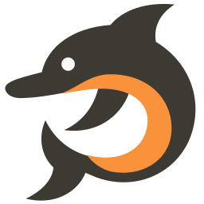
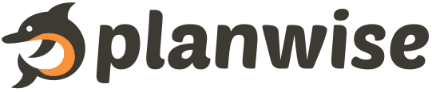

# Brand guide

## Identity

- **Name:** PlanWise in text, lowercase `planwise` in the logo and in identifiers.
- **Tagline:** Plan on your own. Get it done together.
- **Symbol:** a dolphin. It is smart, which is the "wise", and it is as capable alone as in a pod, which matches the two phases.
- **Voice:** calm, clear and friendly. Encouraging without being cute.

## Logo

| Full logo | Short logo | Horizontal logo |
| --- | --- | --- |
|  |  |  |

In the full logo, the leaping dolphin is the "a": its back forms the stem and its tail closes the bowl.

## Which file to use

All files are in `public/brand/`.

| Situation | Light background | Dark background | Minimum width |
| --- | --- | --- | --- |
| Landing page, sign-in, README, email | `logo-full.svg` | `logo-full-dark.svg` | 180 px |
| App header, sidebar, anything smaller | `logo-horizontal.svg` | `logo-horizontal-dark.svg` | 120 px |
| Collapsed sidebar, avatar, loading screen | `logo-short.svg` | `logo-short-dark.svg` | 32 px |
| One-color full logo | `logo-full-mono-black.svg` | `logo-full-mono-white.svg` | 180 px |
| One-color short logo | `logo-short-mono-black.svg` | `logo-short-mono-white.svg` | 48 px |
| Where SVG is unsupported | `logo-full.png` | `logo-full-dark.png` | 180 px |

Below 180 px the dolphin can be misread as an "o", so switch to the horizontal logo, which spells out the "a".

## Icons

| File | Use |
| --- | --- |
| `app-icon.svg` | Master app icon |
| `favicon.svg` | Tighter crop with a larger eye, for 16 to 32 px |
| `icon-192.png`, `icon-512.png` | Web app manifest |
| `icon-maskable-512.png` | Manifest icon with `purpose: "maskable"` |
| `apple-touch-icon.png` | iOS home screen, 180 px and opaque |

## Usage

- Clear space: the height of the dorsal fin on every side.
- Use the dark files on dark backgrounds instead of recoloring the light ones.
- On photos or busy backgrounds, use a one-color file.
- Do not stretch, rotate, mirror, recolor, outline or add effects.
- Do not retype the wordmark or replace other letters with symbols.
- Do not use the dolphin as a bullet or a generic icon.

## Colors

The logo has no colors of its own. It uses theme tokens: ink for the body and wordmark, and the main button's orange for the belly.

| Part | Token | Light | Dark |
| --- | --- | --- | --- |
| Body and wordmark | `foreground` | `#3D3A34` | `#F2EFE9` |
| Belly | `primary` | `#FA923C` | `#FA923C` |
| Eye | `background` | `#FAF9F7` | `#1E1C1A` |

The app icon and favicon reverse this, like the main button: an orange `#FA923C` background, a `#3D3A34` dolphin and a `#FAF9F7` belly.

The logo is flat. Do not add gradients or other colors. If a token above changes, regenerate the logo files in the same change. See the [theme](theme.md) for everything else.

## Type

- **Wordmark:** [Poetsen One](https://fonts.google.com/specimen/Poetsen+One), SIL Open Font License, converted to outlines. It is not a UI font and does not need to be installed.
- **Product:** Nunito Sans and Geist Mono, as described in the [theme](theme.md#typography).
