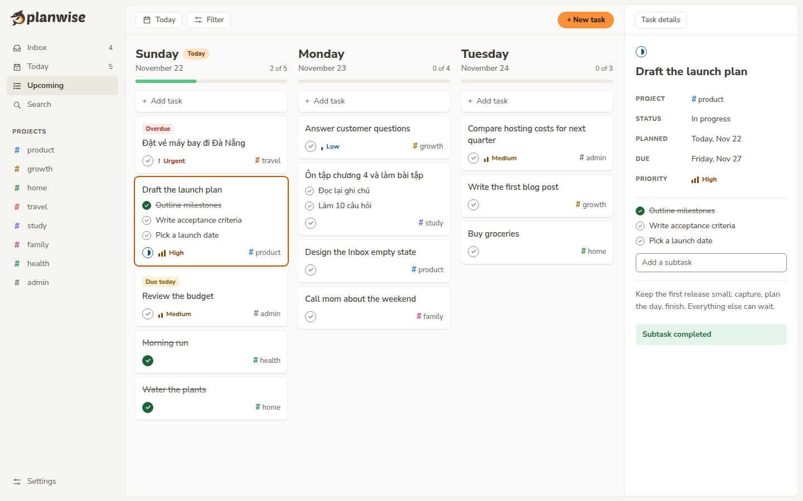
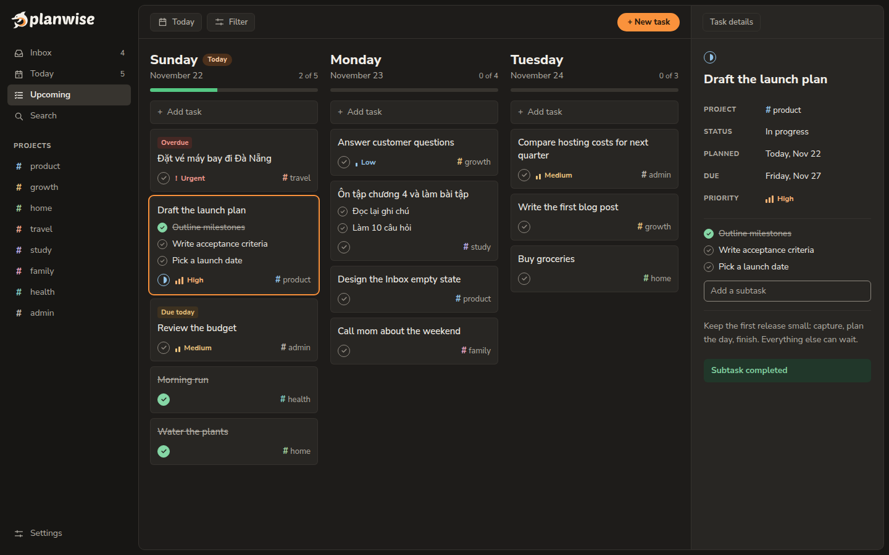

# Theme: Daybreak and Nightfall

| Mode | Name | Feel |
| --- | --- | --- |
| Light | **Daybreak** | Warm paper, white cards, charcoal text, sunrise-orange actions |
| Dark | **Nightfall** | The same room at night: warm charcoal, cream text, the same orange |

Both modes share one main color, one progress color and one set of neutrals, so switching feels like dimming the lights.

The previews illustrate style. They add no requirements; scope stays in the product docs.

Daybreak takes its calm, paper-like style from Sunsama. Borrow the feel only: never use Sunsama's name, logo, illustrations, icons, copy or other assets.

## Main colors

| Role | Light | Dark | Use for |
| --- | --- | --- | --- |
| **Main** | Sunrise `#FA923C` | Sunrise `#FA923C` | The one main action on a screen |
| **Progress** | Leaf `#55C783` | Leaf `#55C783` | Progress and completion |
| **Navigation** | Paper `#F6F5F1` | `#171614` | Sidebar |
| **Canvas** | `#FAF9F7` | `#1E1C1A` | Area behind cards |
| **Card** | `#FFFFFF` | `#282623` | Tasks, inputs, detail pane |
| **Text** | Charcoal `#3D3A34` | Cream `#F2EFE9` | Main text |
| **Danger** | `#A32D23` | `#F59A8F` | Errors, overdue, deletion |

## Style principles

1. **Paper, not chrome.** Structure comes from warm neutrals and hairlines, not colored bars.
2. **Quiet until it matters.** One orange button per screen. Project color appears as a small `#`, not a filled card.
3. **The task title leads.** Metadata is smaller and muted.
4. **Small corners, soft lift.** Cards have 6 px corners and a barely visible shadow.
5. **The day is the unit.** Planning views group work under a large day name, a muted date and thin progress.

## Rules

1. Components use semantic tokens only, never hex values or scale steps.
2. Tokens change with the theme, so components rarely need a `dark:` variant.
3. Color never carries meaning alone. Add text or an icon.
4. Text uses a text token, or the `*-foreground` or `on-*` token that belongs to its fill.
5. `border` is decorative. Anything interactive uses `input`.
6. Never put white text on Sunrise; it fails contrast. Use `primary-foreground`.
7. A new pairing needs at least 4.5:1 for text and 3:1 for controls and focus.

## Scales

These are raw values for defining tokens, illustrations and marketing.

| Step | Sunrise | Sand | Leaf |
| --- | --- | --- | --- |
| 50 | `#FFF7EF` | `#FAF9F7` | `#F1FBF4` |
| 100 | `#FFEBD8` | `#F6F5F1` | `#E3F5E9` |
| 200 | `#FFD2AA` | `#EAE8E2` | `#BFE9CE` |
| 300 | `#FDB476` | `#CDCAC1` | `#8FDAAB` |
| 400 | `#FA923C` | `#A9A69D` | `#55C783` |
| 500 | `#E2741C` | `#87847B` | `#35A865` |
| 600 | `#BE5700` | `#625F58` | `#278750` |
| 700 | `#8F3F00` | `#504D47` | `#1B6339` |
| 800 | `#743400` | `#3D3A34` | `#17512F` |
| 900 | `#572700` | `#2A2824` | `#123F26` |
| 950 | `#2B1A0D` | `#181714` | `#0E2E1B` |

## Semantic tokens

In Tailwind 4 each token becomes `--color-<token>`, giving classes such as `bg-card` and `text-muted-foreground`. The names follow [shadcn/ui](../decisions/0006-shadcn-ui.md): `muted` and `accent` are fills, never text or progress.

### Surfaces

| Token | Light | Dark | Use |
| --- | --- | --- | --- |
| `background` | `#FAF9F7` | `#1E1C1A` | Main canvas behind cards |
| `sidebar` | `#F6F5F1` | `#171614` | Navigation, warm paper |
| `card` | `#FFFFFF` | `#282623` | Cards, task rows, inputs |
| `muted` | `#F2F1EC` | `#2F2D29` | Hover, count and time chips |
| `popover` | `#FFFFFF` | `#33302C` | Menus, dialogs, popovers |
| `selected` | `#EAE8E1` | `#37342F` | Selected row, active navigation |
| `overlay` | `rgb(48 43 36 / 0.32)` | `rgb(0 0 0 / 0.6)` | Behind dialogs |

### Text

| Token | Light | Dark | Use |
| --- | --- | --- | --- |
| `foreground` | `#3D3A34` | `#F2EFE9` | Main text |
| `muted-foreground` | `#625F58` | `#B3AEA5` | Secondary text, placeholders |
| `link` | `#8F3F00` | `#FDB476` | Links, active navigation text |

### Lines

| Token | Light | Dark | Use |
| --- | --- | --- | --- |
| `border` | `#EAE8E2` | `#35322E` | Decorative dividers only |
| `input` | `#87847B` | `#8E887F` | Inputs, checkboxes, control outlines |
| `ring` | `#BE5700` | `#FA923C` | Focus ring |

### Actions

| Token | Light | Dark | Use |
| --- | --- | --- | --- |
| `primary` | `#FA923C` | `#FA923C` | Main button, checked control |
| `primary-hover` | `#FFA65C` | `#FFA65C` | Hovered main button |
| `primary-pressed` | `#EF8732` | `#EF8732` | Pressed main button |
| `primary-foreground` | `#2B1A0D` | `#2B1A0D` | On any primary fill |
| `progress` | `#55C783` | `#55C783` | Progress, completion moments |
| `progress-foreground` | `#0E2E1B` | `#0E2E1B` | On progress |
| `highlight` | `#FFE3C7` | `#4C301B` | Today marker, use sparingly |
| `on-highlight` | `#6E3000` | `#FFD2AA` | On highlight |
| `destructive` | `#B83227` | `#F59A8F` | Delete button |
| `on-destructive` | `#FFFFFF` | `#3A100C` | On destructive |

### shadcn/ui roles

Components from shadcn/ui also expect these. Each takes the value of another token.

| Token | Same as |
| --- | --- |
| `card-foreground`, `popover-foreground`, `accent-foreground`, `sidebar-accent-foreground` | `foreground` |
| `secondary` | `card` |
| `secondary-foreground`, `sidebar-foreground` | `muted-foreground` |
| `accent` | `muted` |
| `sidebar-accent` | `selected` |
| `sidebar-primary`, `sidebar-primary-foreground` | `primary`, `primary-foreground` |
| `sidebar-border` | `border` |
| `sidebar-ring` | `ring` |

### Feedback

| Token | Light | Dark | Use |
| --- | --- | --- | --- |
| `success` | `#1B6339` | `#85D6A5` | Success text and icon |
| `success-soft` | `#E3F5E9` | `#21372A` | Success background |
| `warning` | `#78500F` | `#EBC47E` | Warning text and icon |
| `warning-soft` | `#FDF0D5` | `#3D3120` | Warning background |
| `danger` | `#A32D23` | `#F59A8F` | Error text and icon |
| `danger-soft` | `#FCEDEA` | `#452824` | Error background |
| `info` | `#14598A` | `#94C5EA` | Information text and icon |
| `info-soft` | `#E5F2FC` | `#22333F` | Information background |

### Task status

| Token | Light | Dark | Use |
| --- | --- | --- | --- |
| `status-todo` | `#625F58` | `#B3AEA5` | To do: empty circle |
| `status-in-progress` | `#14598A` | `#94C5EA` | In progress: half circle |
| `status-done` | `#1B6339` | `#85D6A5` | Done: filled circle with check |

### Task priority

| Token | Light | Dark | Use |
| --- | --- | --- | --- |
| `priority-none` | `#625F58` | `#B3AEA5` | None: no icon |
| `priority-low` | `#14598A` | `#94C5EA` | Low: one bar |
| `priority-medium` | `#78500F` | `#EBC47E` | Medium: two bars |
| `priority-high` | `#8F3F00` | `#FDB476` | High: three bars |
| `priority-urgent` | `#A32D23` | `#F59A8F` | Urgent: exclamation mark |

## Project and label colors

Users pick from these eight. The database stores the key, never a hex value, so each color adapts to the theme.

| Key | Light mark | Light fill | Light text | Dark fill | Dark text and mark |
| --- | --- | --- | --- | --- | --- |
| `ocean` | `#1F7FC4` | `#E2F2FF` | `#14558A` | `#22333F` | `#94C5EA` |
| `lagoon` | `#12857A` | `#DDF4F1` | `#0D5C54` | `#203734` | `#83CEC4` |
| `kelp` | `#2F8745` | `#E2F5E5` | `#265D30` | `#273626` | `#A3D39F` |
| `sun` | `#A86E08` | `#FFF0CC` | `#70490A` | `#3D3120` | `#EBC47E` |
| `coral` | `#CB5539` | `#FDE9E2` | `#8A3420` | `#452B24` | `#F4AA90` |
| `anemone` | `#C64580` | `#FCE7F0` | `#87264F` | `#412733` | `#E9A6C4` |
| `urchin` | `#7E5BE0` | `#EEE9FF` | `#55389F` | `#312C44` | `#BEAFEA` |
| `pebble` | `#7B786F` | `#EFEEE9` | `#55524B` | `#33302C` | `#C4BFB6` |

Tokens are `palette-<key>-mark`, `palette-<key>` and `palette-<key>-foreground`. Show a project as a `mark` colored `#` followed by its name in `muted-foreground`. Use fill and text only for label chips. The default is `ocean`.

## Layout

| Region | Wide: 1280 px and up | Medium: 768 to 1279 px | Small: under 768 px |
| --- | --- | --- | --- |
| Sidebar | 224 px on `sidebar` | Collapsible | Drawer |
| Main | Inset panel on `background`, 10 px corners | Same | Full screen |
| Toolbar | 54 px, outline buttons left, main action right | Same | Title and add button |
| Upcoming | Day columns, 272 px, scrolling sideways | Day columns | One day after another |
| Task detail | 312 px right pane on `card` | Overlay sheet | Full screen |

## Components

| Component | Treatment |
| --- | --- |
| Main button | Pill, `primary` with `primary-foreground`, weight 750 |
| Secondary button | `secondary` with `secondary-foreground` text and icon, `border`, 6 px corners |
| Navigation item | 34 px, line icon, `muted-foreground`; active is `selected` with bold `foreground` |
| Day header | Day name, muted date and count, 6 px `progress` bar |
| Add task | A white card at the top of each column, plus sign and muted label |
| Task card | `card`, 12 px padding, 8 px gap, card shadow |
| Card content | Optional date chip, title, subtasks, then a row with check, priority and project |
| Check | 20 px circle, 16 px for subtasks, with a hit area of at least 44 px on touch screens |
| Icons | Outline, 1.5 px stroke, rounded ends, in the current text color |

## Adding a shadcn component

`npx shadcn@4.23.0 add <name>` copies the source into `components/ui/`. Install what it imports and run
`npm run fix`. Its colors already follow the theme. Fix these before using it, because the downloaded defaults break
the rules above:

- Focus: replace `outline-none` and `ring-ring/50` with the solid focus state below. At half opacity it fails 3:1.
- Text in `text-primary` (the link variant): use `link`. Sunrise text fails contrast on light surfaces.
- Control outlines in `border-border`: use `input`.
- Error and destructive text: use `danger`, and check it on its fill in both modes.
- Shape and size: pill main button, the corners above, and 44 px primary touch targets.
- Palette colors such as `bg-black/10` behind dialogs: use a token, here `overlay`. Lint refuses them.
- Code style: export on the declaration instead of shadcn's `export { … }` list. Lint refuses the list.

## Component states

| State | Treatment |
| --- | --- |
| Hover | `muted` for rows, `primary-hover` for main buttons |
| Pressed | `primary-pressed` for main buttons |
| Selected | `selected` plus a check, bar or bolder text |
| Focus | 2 px `ring` with a 2 px offset |
| Disabled | 50% opacity, with the reason available as text |
| Error | `danger` border, icon and message |
| Completed task | `muted-foreground` title and a filled check |
| Overdue | `danger` on `danger-soft`, labeled "Overdue" |
| Due today | `warning` on `warning-soft`, labeled "Due today" |

## Typography

[Nunito Sans](https://fonts.google.com/specimen/Nunito+Sans) for UI, in both modes: an open-licensed humanist sans with full Vietnamese support. Geist Mono for IDs and code.

Load Nunito Sans through `next/font/google` as a variable font with the `latin` and `vietnamese` subsets.

| Style | Size / line height | Weight | Use |
| --- | --- | --- | --- |
| Display | 40 / 48 px | 800 | Landing page only |
| Day | 22 / 28 px | 780 | Day and page titles |
| Heading | 20 / 27 px | 760 | Task detail, dialog title |
| Reading | 16 / 24 px | 400 | Long notes, mobile inputs |
| Task | 15 / 21 px | 500 | Task titles |
| UI | 14 / 20 px | 400 or 600 | Navigation, subtasks, fields |
| Meta | 12 or 13 / 18 px | 400 or 700 | Counts, project, priority |
| Section | 11 / 16 px | 750, uppercase, 0.06 em tracking | Sidebar and field labels |

Inputs are at least 16 px on mobile to prevent zoom on focus.

## Shape and space

| Token | Value | Use |
| --- | --- | --- |
| `radius-sm` | 4 px | Date chips, checklist controls |
| `radius-md` | 6 px | Cards, buttons, inputs, navigation |
| `radius-lg` | 10 px | Main panel, popovers |
| `radius-xl` | 14 px | Dialogs, sheets |
| `radius-full` | 9999 px | Main button, Today marker, avatars, progress |
| Spacing | 4 px steps | Prefer 4, 8, 12, 16, 24, 32, 48 |

## Elevation

| Level | Light | Dark |
| --- | --- | --- |
| Panel | `border`, no shadow | `border`, no shadow |
| Card | `0 1px 1px rgb(48 43 36 / 0.12), 0 0 0 1px rgb(48 43 36 / 0.035)` | `border`, no shadow |
| Popover | `0 4px 14px rgb(48 43 36 / 0.12)` | `popover` and `border` |
| Dialog | `0 8px 28px rgb(48 43 36 / 0.18)` | `popover`, `border` and `overlay` |

## Motion

| Token | Value | Use |
| --- | --- | --- |
| `duration-fast` | 120 ms | Hover, press, check |
| `duration-base` | 200 ms | Popovers, reordering |
| `duration-slow` | 320 ms | Sheets, completion moment |
| `ease-swim` | `cubic-bezier(0.22, 1, 0.36, 1)` | All entrances and movement |

With reduced motion requested, remove movement and keep opacity changes only.

## Light, dark and system

- The choices are `system`, `light` and `dark`. The default is `system`.
- `system` sets no attribute and follows `prefers-color-scheme`. The other two set `data-theme` on `<html>`.
- Save the choice to the account and mirror it in a `theme` cookie.
- Apply the cookie with a small constant inline script before first paint. **Do not read it with `cookies()` in the root layout**, which would block prerendering under Cache Components. See the bundled Next.js guide `preventing-flash-before-hydration.md`.
- The content security policy must allow that script, for example by hash.
- Set `color-scheme` so native controls match.

## Contrast

Every text token was measured on every surface, along with fills, soft backgrounds, project colors, control borders and the focus ring.

| Lowest measured ratio | Light | Dark | Required |
| --- | --- | --- | --- |
| Text | 5.19 | 5.61 | 4.5 |
| Controls and focus | 3.30 | 3.73 | 3.0 |
