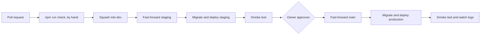

# Deployment

How a change is released, rolled back and watched, and how the domain is changed. There is no CI/CD: every
step is run by hand. This takes effect in M0; nothing is deployed today.

## Flow

| Branch | Deploys to | Database |
|---|---|---|
| `dev` | Nothing | None |
| `staging` | Staging (a Vercel preview) | Neon branch `staging` |
| `main` | Production | Neon branch `main` |

Vercel's Git integration stays off for automatic deploys: a deploy happens only when the maintainer runs it, from a
clean checkout of the pushed branch. Branch rules: [git-conventions.md](../development/git-conventions.md).

## Setting up, once

Done in M0 for staging and at launch for production. Each step is the owner's.

1. Create the Vercel project from this repository. Turn off automatic deployments and preview comments.
2. Create the Neon project in `aws-ap-southeast-1` (Singapore), Postgres 18, with autoscaling 0.25 to 0.5 CU and a
   `staging` branch.
3. Set the [settings](../platform/hosting.md#settings) for each environment in Vercel. `DATABASE_URL` is the branch's
   pooled connection string. Never set `APP_ENV`.

## Required checks

Run on the commit being deployed:

1. `npm ci`
2. `npm run check`: [the static checks, build and integration tests](../development/code-conventions.md#9-enforcement)
3. End-to-end tests against the staging deployment, once they exist

## Release

1. Confirm that migrations work with the code currently in production.
2. Note the time: Neon can restore the branch to any point in the last 6 hours.
3. Apply migrations: `DATABASE_URL=<branch's direct connection string> npm run db:migrate`.
4. Deploy with `npx vercel@<pinned version> deploy` (`--prod` for production).
5. Smoke-test with a signed-in account and watch errors.
6. Tag the released commit, so what runs can be traced and rolled back to.

Each environment has its own `AUTH_SECRET`. Changing it signs everyone out and voids codes in flight.

## Changing the domain

The domain is configuration. Changing it must never need a code change.

| Setting | Where | Example |
|---|---|---|
| Custom domain | the Vercel project's domains | `app.example.com` |
| `APP_URL` | the environment's variables | `https://app.example.com` |
| `EMAIL_FROM` | the environment's variables | `PlanWise <no-reply@mail.example.com>` |

What keeps it that way:

- `lib/config.ts` is the only reader of both variables. Auth's base URL, origin checks, `metadataBase` and links in
  emails all derive from it.
- Links inside the app are relative.
- Absolute URLs are never stored in the database or in files.
- Cookies are host-only: no `Domain` attribute.

To switch:

1. Add the domain to the Vercel project and set the DNS records Vercel gives.
2. Change the settings above for that environment.
3. If email is live, [set up the sending domain](#setting-up-email) before switching `EMAIL_FROM`.
4. Redeploy, since prerendered pages contain the URL, then smoke-test.
5. Redirect the old domain for a while. Users sign in again, as cookies don't move between hosts.

Until a domain is chosen, the app uses its `vercel.app` address. The candidates are `planwise.id.vn` (preferred, as it
serves only this app) and a subdomain of `fulltech.io.vn`.

## Setting up email

Done in M1. The app can stay on `vercel.app`: only the sender needs a domain.

1. Add a sending subdomain, such as `mail.planwise.id.vn`, at Resend.
2. Add the DNS records it gives (SPF, DKIM) and a DMARC record. The DNS can be hosted anywhere.
3. Create a send-only API key per environment and set it as `RESEND_API_KEY` in Vercel.
4. Set `EMAIL_FROM`, then send a code to an address at two different mail providers and check it isn't spam.

Staging and production share Resend's quota: never load-test against the real sender.

## Rollback

| Problem | Action |
| --- | --- |
| Bad code | Promote the previous deployment in Vercel (instant rollback) |
| Bad migration | Fix forward; old code still works if expand and contract was followed |
| Corrupted data | Stop writes, then restore the Neon branch to a point in the last 6 hours, with owner approval; later writes are lost |
| Leaked secret | Rotate, revoke affected sessions, review logs. Rewriting Git history is not enough: the repository is public. |

Rolling back a deployment does not roll back the database or files.

## Operations

- Watch Vercel's usage page (passing a Hobby limit pauses the project for 30 days) and Neon's compute hours.
- Watch the error rate, p95 latency and failed email.
- Export the database (`pg_dump`) before each production release, since recovery covers only 6 hours. Keep exports
  out of the repository.
- Tokens and connection strings stay in Vercel and `.env.local`, never on GitHub.
- Rehearse a restore before each phase launch.
