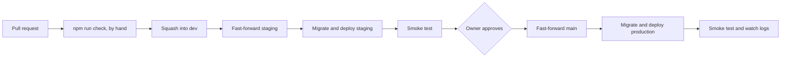

# Deployment

How a change is released, rolled back and watched, and how the domain is changed. There is no CI/CD: every
step is run by hand. This takes effect in M0; nothing is deployed today.

## Flow

| Branch | Deploys to | Command, from M0 |
|---|---|---|
| `dev` | Nothing | None |
| `staging` | Staging | `npm run deploy:staging` |
| `main` | Production | `npm run deploy:production` |

Deploy only from a clean checkout of the pushed branch. Branch rules:
[git-conventions.md](../development/git-conventions.md).

## Required checks

Run on the commit being deployed:

1. `npm ci`
2. `npm run check`: formatting, lint, type check, unit and integration tests
3. The OpenNext build and its bundle size
4. End-to-end and [smoke tests](../development/testing.md#workers-smoke-test) in workerd

## Release

1. Confirm that migrations work with the code currently in production.
2. Record a D1 Time Travel bookmark.
3. Apply migrations.
4. Deploy with the OpenNext CLI, which also populates the cache.
5. Smoke-test with a signed-in account and watch errors.
6. Tag the released commit, so what runs can be traced and rolled back to.

Changes touching several Workers deploy consumers before producers.

## Creating resources

The location is chosen at creation and can't be changed afterwards, so never skip it:

- D1: `wrangler d1 create <name> --location apac`
- R2: `wrangler r2 bucket create <name> --location apac`

## Changing the domain

The domain is configuration. Changing it must never need a code change.

| Setting | Where | Example |
|---|---|---|
| Custom domain | `routes` of each environment in `wrangler.jsonc` | `app.example.com` |
| `APP_URL` | the environment's variables, at build and at runtime | `https://app.example.com` |
| `EMAIL_FROM` | the environment's variables | `PlanWise <no-reply@example.com>` |

What keeps it that way:

- `lib/config.ts` is the only reader of both variables. Auth's base URL and trusted origins, origin checks,
  `metadataBase` and links in emails all derive from it.
- Links inside the app are relative.
- Absolute URLs are never stored in D1, R2 or queue messages.
- Cookies are host-only: no `Domain` attribute.

To switch:

1. Add the domain to the Cloudflare account as an active zone. For a subdomain such as
   `planwise.fulltech.io.vn`, the zone is `fulltech.io.vn`, which must use Cloudflare's nameservers.
2. Change the settings above for that environment.
3. If email is live, onboard the new domain in Email Service before switching `EMAIL_FROM`.
4. Rebuild, since prerendered pages contain the URL, then deploy and smoke-test.
5. Redirect the old domain for a while. Users sign in again, as cookies don't move between hosts.

Until a domain is chosen, staging and production use their `workers.dev` addresses.

## Rollback

| Problem | Action |
| --- | --- |
| Bad code | Roll back the Worker version |
| Bad migration | Fix forward; old code still works if expand and contract was followed |
| Corrupted data | Stop writes, then restore D1 to a bookmark from the last 7 days, with owner approval; later writes are lost |
| Leaked secret | Rotate, revoke affected sessions, review logs. Rewriting Git history is not enough: the repository is public. |

Rolling back a Worker does not roll back D1 or R2. D1 restore does not restore R2 objects.

## Operations

- Watch error 1102 (CPU), error rate, p95 latency, failed email and each daily quota.
- Free keeps Workers Logs for 3 days: investigate promptly.
- Export D1 before each production release, since point-in-time recovery covers only 7 days. Keep exports
  out of the repository.
- API tokens are scoped to the resources of one environment and stay off GitHub.
- Rehearse a restore before each phase launch.
