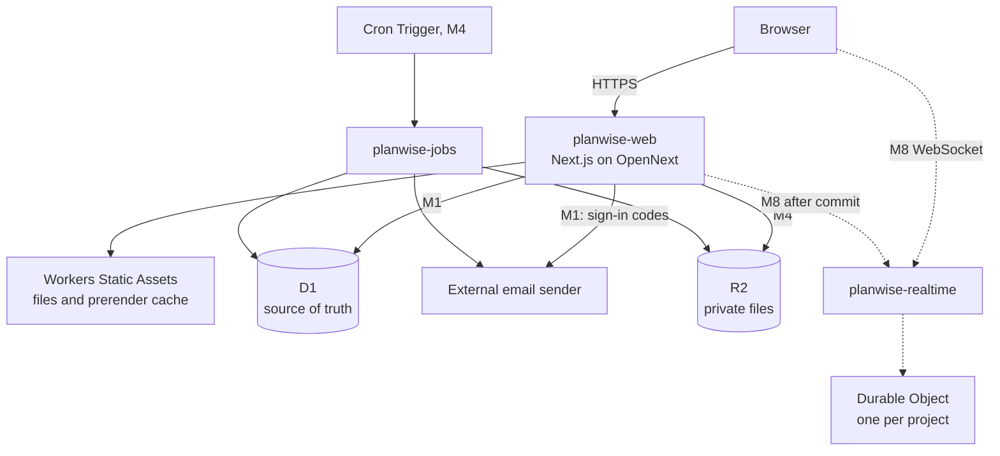
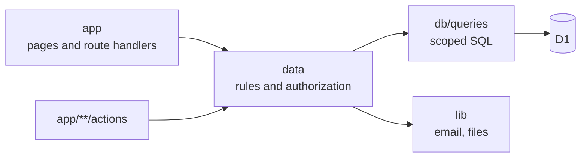

# Architecture

The Workers, how a request flows through them, caching and consistency. This is the target design; none of it
is implemented yet.

## System

| Worker | Responsibility | Arrives in |
| --- | --- | --- |
| `planwise-web` | UI, auth, all user-initiated reads and writes | M0 |
| `planwise-jobs` | Reminders, notification delivery, purging | M4 |
| `planwise-realtime` | WebSockets and presence | M8 |

Separate Workers let jobs and sockets deploy without modifying the OpenNext-generated entry point.

## Layers

Code follows the Next.js project structure, with a Data Access Layer (DAL). What each layer may do and
where its file lives: [code-conventions.md](../development/code-conventions.md#2-layers).

## Reading

1. The route renders a static shell, with user content inside `<Suspense>`.
2. A Server Component calls the DAL.
3. The DAL resolves the session from the cookie and checks it against D1.
4. A query in `db/queries/` runs, scoped by membership.
5. The DAL returns a minimal DTO.

Server Components call the DAL directly, not the app's own HTTP endpoints.

## Writing

1. A Client Component calls a Server Action, optionally updating optimistically.
2. The action calls the DAL, which authenticates, validates and authorizes.
3. The query writes with membership and `version` guards, batching related statements.
4. Side effects run after the commit.
5. The action returns a `Result` (a DAL error translated by `runAction()`) and calls `refresh()` from `next/cache`.

## Caching

| Content | Policy |
| --- | --- |
| Hashed static assets | Served by Workers Static Assets |
| Public pages and static shells | Prerendered, stored in the read-only Static Assets cache; change on deploy |
| Session, tasks, projects, anything user-specific | Read per request; deduplicate with React `cache()` only |
| Anything needing `use cache` or revalidation | Not allowed until an ADR adds a writable cache |

Keeping user data out of shared caches means revoked access takes effect on the next request.

## Consistency

- D1 is the only source of truth. R2, email and Durable Objects never decide permissions or task state.
- D1 cannot commit together with email or R2. Work that must not be lost is recorded in D1 and, from M4, swept
  by the jobs Worker.
- Jobs are idempotent because a sweep can repeat.
- A live update is a hint to refetch. Losing one cannot lose data.
