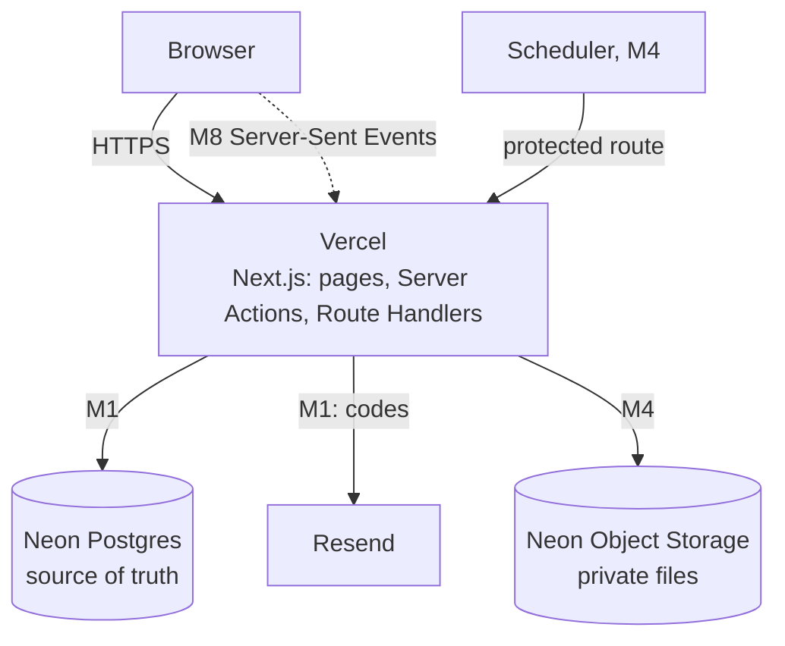
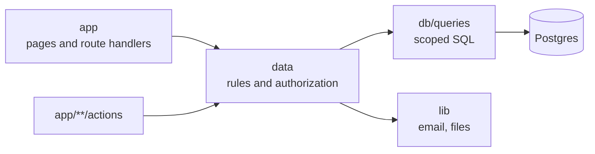

# Architecture

How a request flows through the app, caching and consistency. Today the web app, Postgres and sign-in exist, and only
locally.

## System

| Part | Responsibility | Arrives in |
| --- | --- | --- |
| Next.js on Vercel | UI, auth, all reads and writes, and later jobs and live updates as Route Handlers | M0 |
| Neon Postgres | All data | M1 |
| Neon Object Storage | Attachment files | M4 |
| Scheduler | Calls the job route for reminders and purging ([ADR 0009](../decisions/0009-scheduled-work.md)) | M4 |

One deployable app: jobs and live updates are routes in it, not separate services.

## Layers

Code follows the Next.js project structure, with a Data Access Layer (DAL). What each layer may do and where its file
lives: [code-conventions.md](../development/code-conventions.md#2-layers).

## Reading

1. The route renders a static shell, with user content inside `<Suspense>`.
2. A Server Component calls the DAL.
3. The DAL resolves the session from the cookie and checks it in Postgres.
4. A query in `db/queries/` runs, scoped by membership.
5. The DAL returns a minimal DTO.

Server Components call the DAL directly, not the app's own HTTP endpoints.

## Writing

1. A Client Component calls a Server Action, optionally updating optimistically.
2. The action calls the DAL, which authenticates, validates and authorizes.
3. The query writes inside a transaction, with membership and `version` guards.
4. Side effects run after the commit.
5. The action returns a `Result` (a DAL error translated by `runAction()`) and calls `refresh()` from `next/cache`.

## Caching

| Content | Policy |
| --- | --- |
| Hashed static assets | Served by Vercel's CDN |
| Public pages and static shells | Prerendered at build; change on deploy |
| Session, tasks, projects, anything user-specific | Read per request; deduplicate with React `cache()` only |
| Anything shared through `use cache` | Not without an ADR: no user data in a shared cache, ever |

Keeping user data out of shared caches means revoked access takes effect on the next request.

## Consistency

- Postgres is the only source of truth. Files, email and live events never decide permissions or task state.
- Postgres cannot commit together with email or file storage. Work that must not be lost is recorded in Postgres and,
  from M4, picked up by the job route.
- Jobs are idempotent, because a schedule can run twice.
- A live update is a hint to refetch. Losing one cannot lose data.
