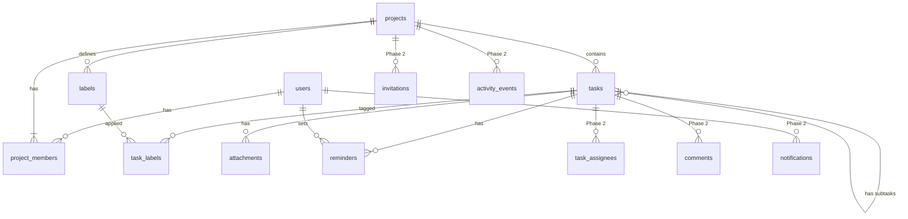

# Data model

The database is D1 (SQLite). This is the logical design; the Drizzle schema becomes authoritative once it exists.

## Relationships

## Column conventions

| Topic | Rule |
| --- | --- |
| Names | `snake_case`; plural tables; `<entity>_id` foreign keys |
| IDs | UUIDv7 as `TEXT`, created on the server |
| Instants | UTC epoch milliseconds as `INTEGER`, suffix `_at` |
| Calendar days | `TEXT` as `YYYY-MM-DD`, suffix `_on` |
| Booleans | `INTEGER` 0 or 1, prefix `is_` or `has_` |
| Enums | `TEXT` with a `CHECK` constraint |
| Order | Fractional index as `TEXT`, named `position`, with `id` as tie-breaker |
| Timestamps | `created_at` and `updated_at` on every mutable table |
| Concurrency | Integer `version` on projects, tasks and comments |
| Deletion | `deleted_at` on projects and tasks, purged after 30 days |

## Phase 1 tables

Better Auth owns `users`, `sessions`, `accounts` and `verifications`, configured to follow these naming rules where it allows. `users` also stores `timezone` (IANA name) and `theme` (`system`, `light` or `dark`). Every `color` column stores a [palette key](../brand/theme.md#project-and-label-colors), never a hex value.

| Table | Columns besides timestamps | Key constraints |
| --- | --- | --- |
| `projects` | `id`, `kind`, `created_by`, `name`, `color`, `position`, `version`, `archived_at`, `deleted_at` | `kind` is `inbox` or `standard`; unique `created_by` where kind is inbox |
| `project_members` | `project_id`, `user_id`, `role` | Primary key on both IDs; unique `project_id` where role is owner |
| `tasks` | `id`, `project_id`, `parent_id`, `created_by`, `title`, `notes`, `status`, `priority`, `planned_on`, `due_on`, `position`, `completed_at`, `version`, `deleted_at` | Unique `(id, project_id)`; `(parent_id, project_id)` references it |
| `labels` | `id`, `project_id`, `name`, `color` | Unique `(project_id, lower(name))`; unique `(id, project_id)` |
| `task_labels` | `task_id`, `label_id`, `project_id` | Both composite foreign keys include `project_id` |
| `attachments` | `id`, `task_id`, `uploaded_by`, `file_name`, `content_type`, `size_bytes`, `state` | `state` is `pending`, `ready` or `deleting` |
| `reminders` | `id`, `task_id`, `user_id`, `remind_at`, `state`, `sent_at` | Unique `(task_id, user_id, remind_at)` |
| `email_usage` | `day`, `purpose`, `count` | Primary key on day and purpose; incremented with a guard on the budget |
| `tasks_fts` | `title`, `notes` | FTS5, kept in sync by triggers |

`projects.created_by` is history only. **Ownership and access come only from `project_members`.**

Phase 1 writes a single `owner` membership for every project, including Inbox. Phase 2 adds rows; it does not change how access is checked.

## Phase 2 tables

| Table | Purpose | Key constraints |
| --- | --- | --- |
| `invitations` | Pending access | Token stored only as a hash; has expiry; one pending per project and email |
| `ownership_transfers` | Offer awaiting acceptance | One pending per project |
| `task_assignees` | Responsibility | Carries `project_id`; references both the task and the membership, so only members can be assigned |
| `comments` | Discussion | Author retained for history; soft-deleted |
| `activity_events` | History | Append-only; stores IDs and changed field names, not content |
| `notifications` | Per-user inbox | Unique delivery key to prevent duplicates |

Do not create these tables during Phase 1.

## Invariants

1. Every task belongs to exactly one project. "No project" means Inbox.
2. Every project has exactly one owner. The index enforces at most one; the DAL and tests enforce at least one.
3. An Inbox has one member and cannot be shared, archived or deleted except with the account.
4. A subtask shares its parent's project and cannot have subtasks.
5. A label can be applied only within its project.
6. `completed_at` is set if and only if status is `done`.
7. A deleted project hides everything inside it without rewriting child rows.

## Initial indexes

| Index | Serves |
| --- | --- |
| `project_members(user_id, project_id)` | Access checks and project list |
| `tasks(project_id, status, position)` where not deleted | List and board |
| `tasks(project_id, planned_on)` where open and not deleted | Today and Upcoming |
| `tasks(project_id, due_on)` where open and not deleted | Today and overdue |
| `tasks(parent_id, project_id)` | Subtasks |
| `task_labels(label_id)` | Label filter |
| `attachments(task_id)` | Task detail and purge |
| `reminders(state, remind_at)` | Due reminder scan |

Check new queries with `EXPLAIN QUERY PLAN`.

## Writing safely on D1

- **Atomicity:** use `db.batch()`. A failed statement rolls back the batch. Interactive transactions are unavailable.
- **Zero-row updates are not failures.** A failed guard does not roll back a batch. Dependent statements must repeat the guard and run before the statement that increments `version`.
- **Conflicts:** update with `WHERE id = ? AND version = ?` plus a membership `EXISTS`. Treat zero changed rows as a conflict or denial.
- **Moving a task:** in one batch, delete its label links and its subtasks' links, then update parent and children in a single statement.
- **Search:** always join FTS results to `project_members`.
- **Purging:** delete R2 objects before their metadata rows, so a retry can still find the keys.

## Migrations

- Generate with Drizzle Kit into `db/migrations/`, read the SQL, and apply with Wrangler.
- Migrations run only when someone runs them: no Worker migrates or alters the schema while serving.
- Applied migrations are immutable. Fix forward.
- Use expand, backfill, switch, then contract across separate releases.
- Table rebuilds need care with cascading foreign keys. Test them on a populated database and use `PRAGMA defer_foreign_keys` where required.
