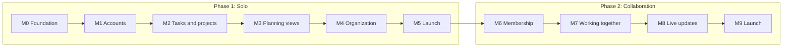

# Roadmap

Milestones are ordered by dependency and have no dates yet. Each must meet its exit criteria before the next begins. A service is created only in the
milestone that [first needs it](platform/hosting.md#services).

## Phase 1: Solo

### M0: Foundation

- [ ] **Gate:** deploy to Vercel and confirm a signed-in page's CPU, memory and cold start leave room in the Hobby and Neon Free limits
- [x] Approve the foundation ADRs (0001 to 0006)
- [x] Create the `dev` and `staging` branches
- [x] On GitHub, protect `main`, `staging` and `dev` and enable private vulnerability reporting
- [x] Align `@types/node` with Node 22 and declare `engines`
- [x] Read every setting only through `lib/config.ts`
- [x] Add formatting, type check, Git hooks and `npm run check`
- [x] Make the checks fail on relative imports, unused imports and variables, `console`, broken import boundaries and an `AGENTS.md` of 200 lines or more
- [ ] Create the Vercel project and staging, and [document the deploy](operations/deployment.md#setting-up-once)
- [ ] Prove a Server Action and `refresh()` work when deployed
- [ ] Implement the [theme](brand/theme.md) in `styles/globals.css`, with the flash-free theme switch
- [x] Remove scaffold content; set the title, description and `app/favicon.ico`
- [x] Load Nunito Sans, including the Vietnamese subset
- [ ] Load Geist Mono
- [ ] Add the web app manifest and Apple touch icon

**Exit:** `npm run check` is green, the gate passes, and staging serves a signed-in page with no runtime errors.

### M1: Accounts

- [ ] Add Drizzle, local Postgres and the migration workflow
- [ ] Create the Neon project and its `staging` branch
- [ ] Create Resend; [set up email](operations/deployment.md#setting-up-email) on the chosen domain; add BotID
- [ ] AUTH-01, AUTH-03 and AUTH-05
- [ ] AUTH-04
- [ ] The email budget and rate limits
- [x] Security headers
- [ ] Email sending, with its bot check
- [ ] Authorization module with an owner membership row for every project

**Exit:** two test users can sign in on staging and neither can read the other's Inbox.

### M2: Tasks and projects

- [ ] TASK-01 to TASK-06
- [ ] PROJ-01 to PROJ-03

**Exit:** the full task and project lifecycle works, including conflict and denial tests.

### M3: Planning views

- [ ] VIEW-01 to VIEW-05

**Exit:** timezone boundary tests pass and every view works by keyboard and on mobile.

### M4: Organization

- [ ] ORG-01 to ORG-03, FILE-01, REM-01
- [ ] DATA-01 and DATA-02
- [ ] Create the Neon Object Storage bucket when FILE-01 starts, not before ([ADR 0008](decisions/0008-files-in-neon.md))
- [ ] Decide [ADR 0009](decisions/0009-scheduled-work.md); a protected job route for reminders and purging
- [ ] Attachment caps, per user and app-wide, that keep storage inside its free tier

**Exit:** files and search are access-controlled and jobs are safe to retry.

### M5: Solo launch

- [ ] Create the production environment
- [ ] Accessibility, performance and security passes
- [ ] Restore rehearsal, alerts and spending notifications
- [ ] Privacy policy, terms and name/trademark check

**Exit:** the [Phase 1 release criteria](product/phase-1-solo.md#release-criteria) are met.

## Phase 2: Collaboration

### M6: Membership

- [ ] MEM-01 to MEM-06
- [ ] Full permission matrix tests

**Exit:** a project can be shared, transferred and left safely.

### M7: Working together

- [ ] COL-01 to COL-05, NOTE-01, NOTE-02

**Exit:** two people can finish a project together using reloads only.

### M8: Live updates

- [ ] Measure Server-Sent Events against Hobby's memory limit and write the follow-up to [ADR 0007](decisions/0007-live-updates-over-sse.md)
- [ ] LIVE-01 to LIVE-04

**Exit:** updates, reconnection and revocation pass multi-client tests.

### M9: Collaboration launch

- [ ] Load, abuse and security testing

**Exit:** the [Phase 2 release criteria](product/phase-2-collaboration.md#release-criteria) are met.

## Main risks

| Risk | Impact | Response |
| --- | --- | --- |
| A Vercel Hobby limit is passed | The app is paused for 30 days | Watch usage; keep pages static where possible; Pro if the project earns money |
| Neon's 100 compute-hours run out | Database suspended until next month | Autoscaling capped at 0.5 CU; nothing keeps it awake |
| Open SSE streams use Hobby's memory allowance | Live updates or the app paused | Measure in M8; polling fallback ([ADR 0007](decisions/0007-live-updates-over-sse.md)) |
| The free email quota runs out or is abused | Nobody can sign in | Bot check, rate limits, a budget reserved for sign-in |
| Hobby cron runs once a day | Reminders late | [ADR 0009](decisions/0009-scheduled-work.md) |
| Permission bug when sharing arrives | Data leak | Membership-based access from M1 |
