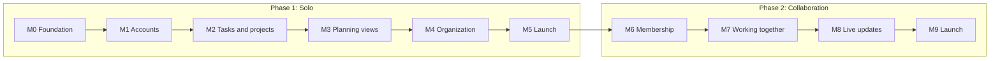

# Roadmap

Milestones are ordered by dependency and have no dates yet. Each must meet its exit criteria before the next begins. A service is created only in the
milestone that [first needs it](platform/cloudflare.md#services).

## Phase 1: Solo

### M0: Foundation

- [ ] **Gate:** prove the stack fits Free's 10 ms of CPU on a real deployment ([ADR 0006](decisions/0006-free-plan.md#cpu)), and that its cache files aren't public there ([ADR 0009](decisions/0009-services-when-needed.md#evidence))
- [x] Approve the foundation ADRs (0001 to 0006)
- [x] Ignore `.dev.vars*`, `.open-next/` and `.wrangler/` in Git
- [ ] Add OpenNext, Wrangler and typed bindings
- [ ] Configure the Static Assets incremental cache and prove a page works in workerd
- [ ] Prove a Server Action and `refresh()` work in workerd
- [ ] Read `APP_URL` only through `lib/config.ts`
- [ ] Align `@types/node` with Node 22 and declare `engines`
- [x] Create the `dev` and `staging` branches
- [x] On GitHub, protect `main`, `staging` and `dev` and enable private vulnerability reporting
- [ ] Add formatting, type check, test runners, `npm run check` and the deploy scripts
- [ ] Make the checks fail on relative imports, dead code, `console`, broken import boundaries and an `AGENTS.md` of 200 lines or more
- [ ] Implement the [theme](brand/theme.md) in `app/globals.css`, with the flash-free theme switch
- [x] Remove scaffold content; set the title, description and `app/favicon.ico`
- [ ] Load Nunito Sans, including the Vietnamese subset, and Geist Mono
- [ ] Add the web app manifest and Apple touch icon

**Exit:** `npm run check` is green, CPU fits the plan, and staging serves a page with a cookie attached and shows no runtime errors.

### M1: Accounts

- [ ] Create D1 in `apac`; add Drizzle and the migration workflow
- [ ] Create Resend and Turnstile; [set up email](operations/deployment.md#setting-up-email) on the chosen domain
- [ ] Repeat the CPU check with a session lookup in D1
- [ ] AUTH-01 and AUTH-03 to AUTH-05
- [ ] Email sending with its budget, bot check, rate limits and security headers
- [ ] Authorization module with an owner membership row for every project

**Exit:** two test users can sign in and neither can read the other's Inbox.

### M2: Tasks and projects

- [ ] TASK-01 to TASK-06
- [ ] PROJ-01 to PROJ-03

**Exit:** the full task and project lifecycle works, including conflict and denial tests.

### M3: Planning views

- [ ] VIEW-01 to VIEW-05

**Exit:** timezone boundary tests pass and every view works by keyboard and on mobile.

### M4: Organization

- [ ] ORG-01 to ORG-03, FILE-01, REM-01
- [ ] DATA-01 and DATA-02
- [ ] Create R2 in `apac` when FILE-01 starts, not before
- [ ] Jobs Worker with a Cron Trigger, for reminders and purging
- [ ] Attachment caps, per user and app-wide, that keep R2 inside its free tier

**Exit:** files and search are access-controlled and jobs are safe to retry.

### M5: Solo launch

- [ ] Create the production environment
- [ ] Accessibility, performance and security passes
- [ ] Restore rehearsal, alerts and spending notifications
- [ ] Privacy policy, terms and name/trademark check

**Exit:** the [Phase 1 release criteria](product/phase-1-solo.md#release-criteria) are met.

## Phase 2: Collaboration

### M6: Membership

- [ ] MEM-01 to MEM-06
- [ ] Full permission matrix tests

**Exit:** a project can be shared, transferred and left safely.

### M7: Working together

- [ ] COL-01 to COL-05, NOTE-01, NOTE-02

**Exit:** two people can finish a project together using reloads only.

### M8: Live updates

- [ ] ADR for the real-time protocol
- [ ] LIVE-01 to LIVE-04

**Exit:** updates, reconnection and revocation pass multi-client tests.

### M9: Collaboration launch

- [ ] Load, abuse and security testing

**Exit:** the [Phase 2 release criteria](product/phase-2-collaboration.md#release-criteria) are met.

## Main risks

| Risk | Impact | Response |
| --- | --- | --- |
| OpenNext does not fully support Cache Components | Broken rendering | Pin versions, smoke-test in workerd, fall back as described in [ADR 0002](decisions/0002-nextjs-on-workers.md) |
| `proxy.ts` is broken on the adapter | 500 for signed-in users | Banned; auth lives in the server layer |
| Free allows 10 ms of CPU; local tests measured 16 to 27 ms | Pages fail with error 1102 | Gate at the start of M0 |
| The free email quota runs out or is abused | Nobody can sign in | Bot check, rate limits, a budget reserved for sign-in |
| R2 bills above its free tier | The app stops being free | App-wide storage cap, usage alert |
| Free daily quotas run out | Outage until 00:00 UTC | Budgets, indexes, quota alerts |
| One D1 database handles one query at a time | Slow under load | Short indexed queries, pagination, load tests |
| Permission bug when sharing arrives | Data leak | Membership-based access from M1 |
